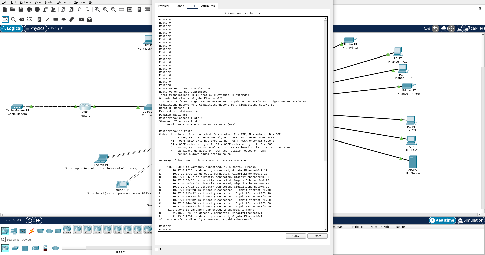
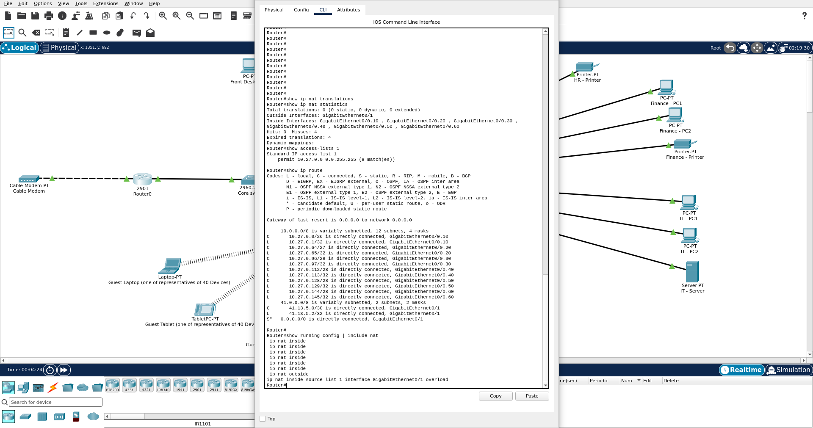
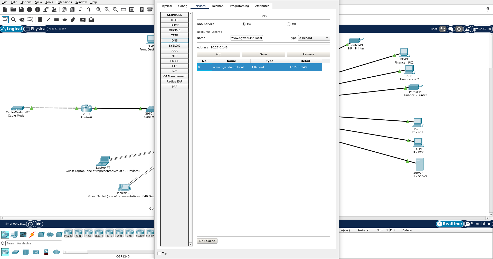
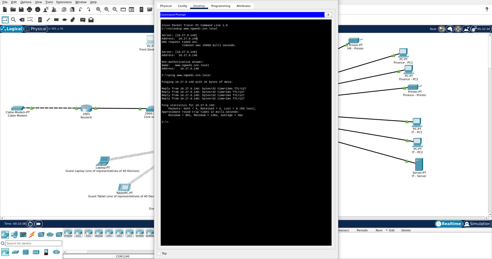
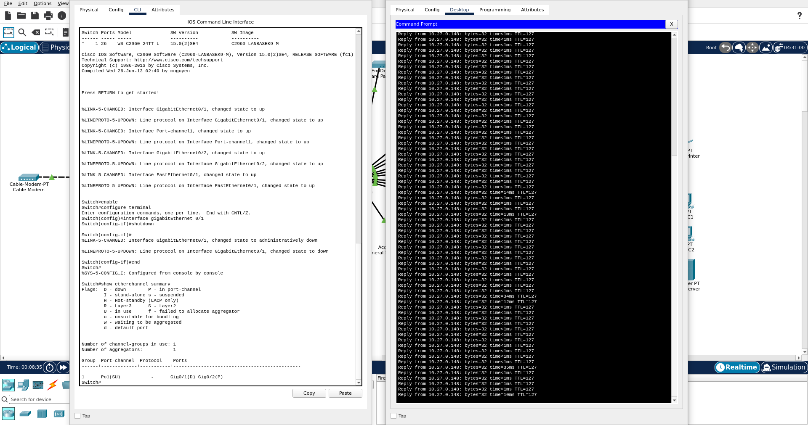
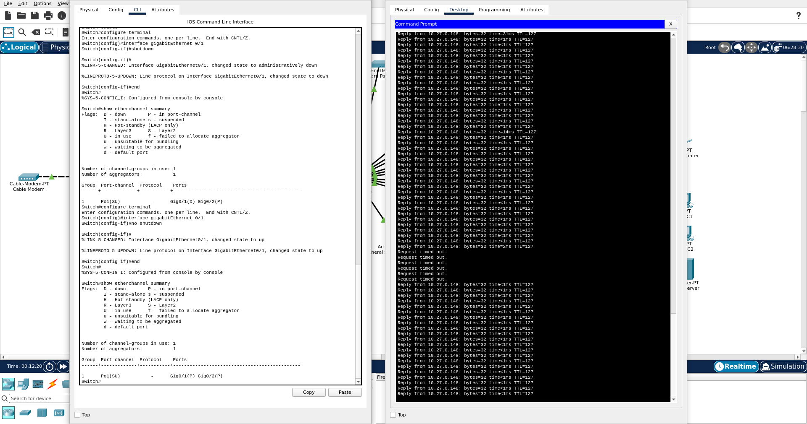

# Additional Testing

Testing carried out after Milestone 2 to close gaps in the original test coverage, using the same final configuration.

## Front Desk, HR and Finance Access to Guest Wifi and General Staff

| Source | Destination | Expected | Result |
|---|---|---|---|
| Front Desk - PC1 | 10.27.0.2 (Guest Wifi) | Blocked | Blocked, destination host unreachable |
| Front Desk - PC1 | 10.27.0.66 (General Staff) | Blocked | Blocked, destination host unreachable |
| HR - PC1 | 10.27.0.2 (Guest Wifi) | Blocked | Blocked, destination host unreachable |
| HR - PC1 | 10.27.0.66 (General Staff) | Blocked | Blocked, destination host unreachable |
| Finance - PC1 | 10.27.0.2 (Guest Wifi) | Blocked | Blocked, request timed out |
| Finance - PC1 | 10.27.0.66 (General Staff) | Blocked | Blocked, request timed out |

Front Desk and HR are blocked at their own sub-interfaces by their access control lists, which is why the router replies with "destination host unreachable". Finance has no access control list of its own, so its requests leave the sub-interface and reach Guest Wifi and General Staff. The replies are then blocked by the access control lists on those two zones, so Finance sees a timeout rather than an unreachable message. This is the same behaviour described for IT/Management in the Design Revisions document.

`show access-lists` after these tests showed four matches on each of the Guest Wifi and General Staff deny lines in the Front Desk and HR access control lists, matching the four packets sent to each destination. The deny lines in the Guest Wifi and General Staff access control lists also recorded three matches each, consistent with Finance's blocked replies.

## NAT Verification

NAT was verified by sending four pings from a Guest Wifi device to 8.8.8.8 and inspecting the router immediately afterwards.

`show ip nat translations` listed three ICMP translations mapping the guest's private address, 10.27.0.3, to the router's outside address, 41.13.5.2, for destination 8.8.8.8. The ICMP identifier differed for each ping, as expected when NAT is overloaded. The statistics recorded four misses and one expired translation, which together account for all four pings. Access list 1, which selects the addresses eligible for translation, recorded 8 matches, compared with none beforehand. `show ip route` confirmed a default route out of GigabitEthernet0/1.

The statistics also recorded zero hits. A hit is a packet matching an existing translation, such as a returning reply. The simulated internet has no host at 8.8.8.8, so no reply returns and the pings timed out. This verifies outbound translation but cannot verify the return path. The pings timed out rather than being rejected as "destination host unreachable", which confirms the Guest Wifi access control list permitted the traffic.

The NAT configuration is present in the router's running configuration:

## DNS Resolution
DNS was configured on the IT Server (10.27.0.148) with an A record for `www.ngwedi-inn.local`. To verify this, a test was run from Front Desk - PC1. The `nslookup` command successfully resolved the domain name to the correct IP address and a subsequent ping confirmed end-to-end connectivity.

## NAT Verification
NAT was verified by sending four pings from a Guest device to 8.8.8.8 and inspecting the router immediately afterwards. The router's NAT statistics recorded 4 misses and 4 expired translations, accounting exactly for the four packets sent. Access list 1, which selects the addresses eligible for translation, recorded 8 matches. 

Because the simulated internet has no host at 8.8.8.8, no reply returns and the pings timed out, but the outbound translation was successfully processed by the router.

## EtherChannel Failover (Redundancy Test)
To verify high availability, a continuous ping (`ping -t`) was initiated from Front Desk - PC1 to the IT Server (10.27.0.148). While the ping was running, link GigabitEthernet0/1 on the Core switch (part of the Port-channel 1 bundle) was administratively shut down. 

`show etherchannel summary` confirmed Gig0/1 went down (D) while Gig0/2 remained active (P) in the bundle. The continuous ping experienced brief timeouts during STP/LACP convergence before automatically recovering and resuming replies, proving the failover routing is successful.

After restoring the link with `no shutdown`, the port successfully rejoined the bundle.

