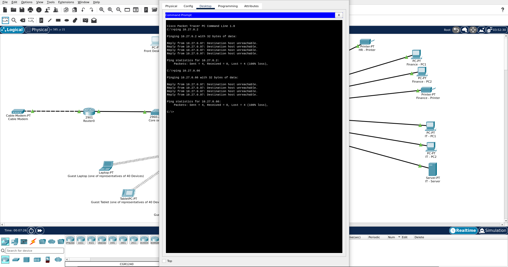
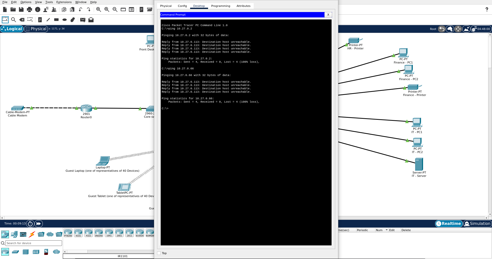
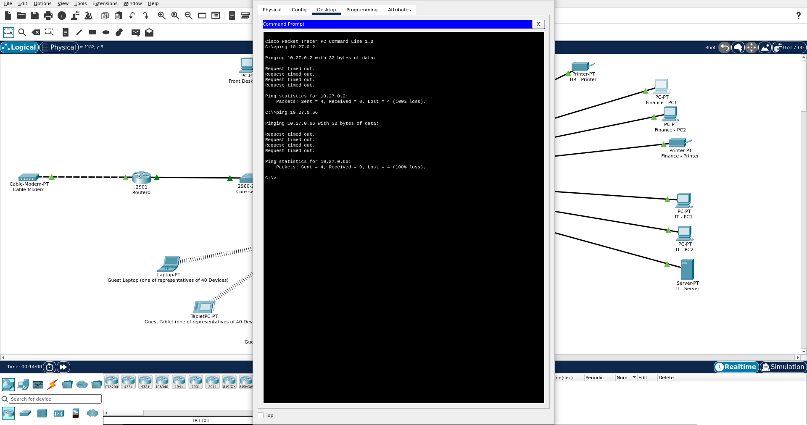
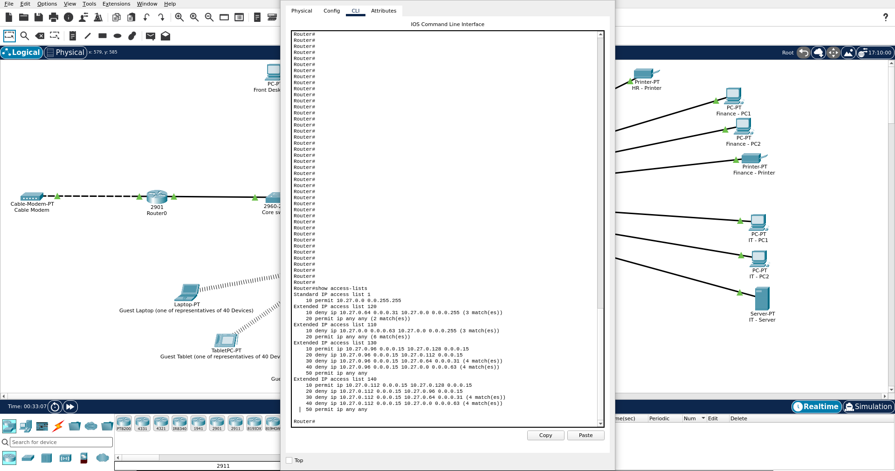

# Additional Testing

Testing carried out after Milestone 2 to close gaps in the original test coverage, using the same final configuration.

## Front Desk, HR and Finance Access to Guest Wifi and General Staff

| Source | Destination | Expected | Result |
|---|---|---|---|
| Front Desk - PC1 | 10.27.0.2 (Guest Wifi) | Blocked | Blocked, destination host unreachable |
| Front Desk - PC1 | 10.27.0.66 (General Staff) | Blocked | Blocked, destination host unreachable |
| HR - PC1 | 10.27.0.2 (Guest Wifi) | Blocked | Blocked, destination host unreachable |
| HR - PC1 | 10.27.0.66 (General Staff) | Blocked | Blocked, destination host unreachable |
| Finance - PC1 | 10.27.0.2 (Guest Wifi) | Blocked | Blocked, request timed out |
| Finance - PC1 | 10.27.0.66 (General Staff) | Blocked | Blocked, request timed out |

Front Desk and HR are blocked at their own sub-interfaces by their access control lists, which is why the router replies with "destination host unreachable". Finance has no access control list of its own, so its requests leave the sub-interface and reach Guest Wifi and General Staff. The replies are then blocked by the access control lists on those two zones, so Finance sees a timeout rather than an unreachable message. This is the same behaviour described for IT/Management in the Design Revisions document.

`show access-lists` after these tests showed four matches on each of the Guest Wifi and General Staff deny lines in the Front Desk and HR access control lists, matching the four packets sent to each destination. The deny lines in the Guest Wifi and General Staff access control lists also recorded three matches each, consistent with Finance's blocked replies.

